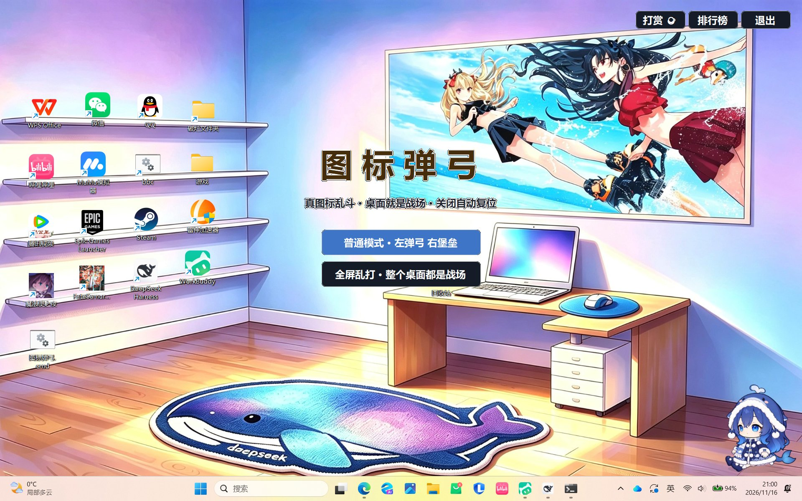
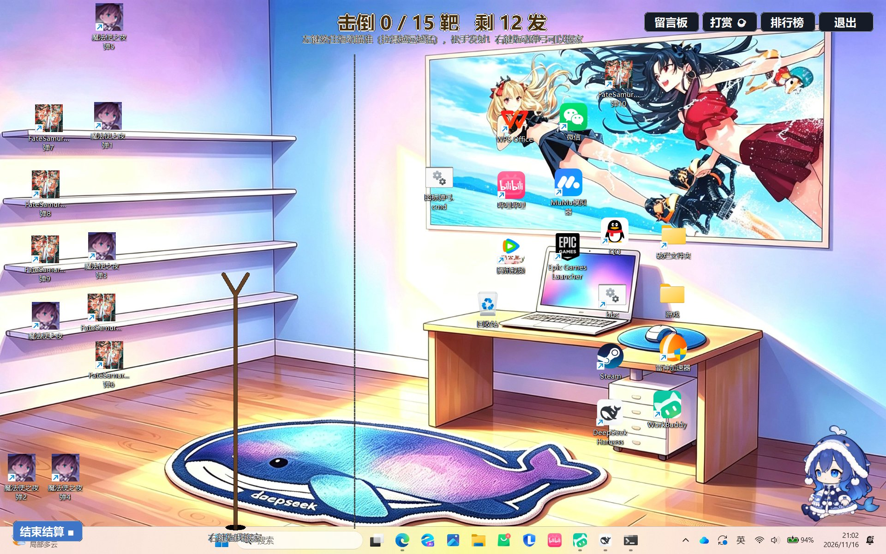

# 图标弹弓 IconSlingshot 🎯

把你的**真实桌面**变成弹弓战场！桌面上躺着的图标就是你的弹丸和砖块，像愤怒的小鸟一样把它们发射出去，砸烂用图标搭起来的堡垒。游戏结束，一切自动复位，桌面毫发无伤。

> 单文件游戏：整个游戏只有一个 `.cmd` 文件，双击即玩，无需安装任何东西。

| 主菜单 | 普通模式·进攻中 |
| :---: | :---: |
|  |  |

## 玩法

1. 下载 `图标弹弓.cmd`，双击运行（所有窗口会自动最小化，桌面就是战场）
2. **建造阶段**：拖动桌面图标摆放你的阵地——
   - **普通模式**：弹丸放左边，靶子摆右边（虚线分区）
   - **全屏乱打**：整个桌面都是战场，弹弓随机出现
   - 空白处按住左键拖一个框，可以一次框选多个图标整组搬运
   - 顶部控制栏可切换模式 / 开始进攻 / 复制弹丸（点哪个图标就复制哪个 ×5）
3. **进攻阶段**：左键按住拖动瞄准（拉得越远越猛），松手发射！
   - 右键按住可以拖动弹弓搬家
   - 弹丸和被打倒的图标都会消失，打完自动结算
4. 结算时输入昵称，成绩自动上传**全网排行榜**

## 排行榜

- 按**得分率**（分数 ÷ 用时）排位，同率先打先排
- 服务端按公式计算得分率；单局分数有物理上限校验。但客户端 key 是公开的，无法阻止有人直接伪造提交，请勿把它当作防作弊机制
- 点「排行榜」实时查看全网 Top 30 + 本机最近 30 局
- 断网时自动回退显示本机成绩，不影响游玩

## 操作一览

| 操作                       | 键位                 |
| ------------------------ | ------------------ |
| 瞄准 / 发射 / 拖图标 / 点按钮 | **左键**             |
| 拖动弹弓搬家               | **右键按住**           |
| 框选多个图标               | 建造阶段空白处左键拖框    |
| 紧急退出                  | **ESC**（桌面立即自动复位） |

## 特性

- **真图标物理引擎**：图标会被撞飞、连锁倒塌、落地消散
- **游戏中锁定桌面**：任何软件都点不开（防止误触打开图标），ESC 秒退游戏
- **自动复位**：退出时所有图标回到原位，复制的弹药图标自动删除
- **字体自适应**：根据壁纸亮度自动切换深浅配色，什么壁纸都看得清
- **复制弹丸**：选什么复制什么 ×5，双模式切换、可拖动控制栏
- **打赏 & 留言板**：觉得好玩可以打赏作者，或者匿名留下你的想法

## 隐私说明

- 排行榜收集：**昵称、分数、用时**——不收集设备信息
- 留言板收集：**留言内容、时间**
- 重要：单文件客户端内置了公开的云服务访问 key，任何拿到它的人都能读取留言与成绩，也可能伪造提交。留言**不是私密聊天**，请勿写入手机号、住址等敏感信息
- 游戏运行数据（日志/本机成绩）只存在你自己电脑的 `%LOCALAPPDATA%\IconSlingshot`，不会上传

## 常见问题

**双击后 Windows 弹"已保护你的电脑"？**  
这是 SmartScreen 对所有未签名脚本的正常提醒。点"更多信息 → 仍要运行"即可。

**游戏卡住了想退出？**  
按 **ESC**，立即退出并自动复位桌面图标。

**玩完桌面图标乱了？**  
不会。游戏退出时自动按快照把每个图标放回原位；复制出来的弹药图标也会被删掉。

**系统要求**  
Windows 10 / 11（PowerShell 和 .NET Framework 系统自带，无需安装）。

## 反馈

有问题、想吐槽、或者有新小游戏点子——游戏里点「留言板」直接留言，或者加 QQ：**3967454362**（人鱼混用，人能看到）。

## License

[MIT](LICENSE) © 2026 Masterbble
